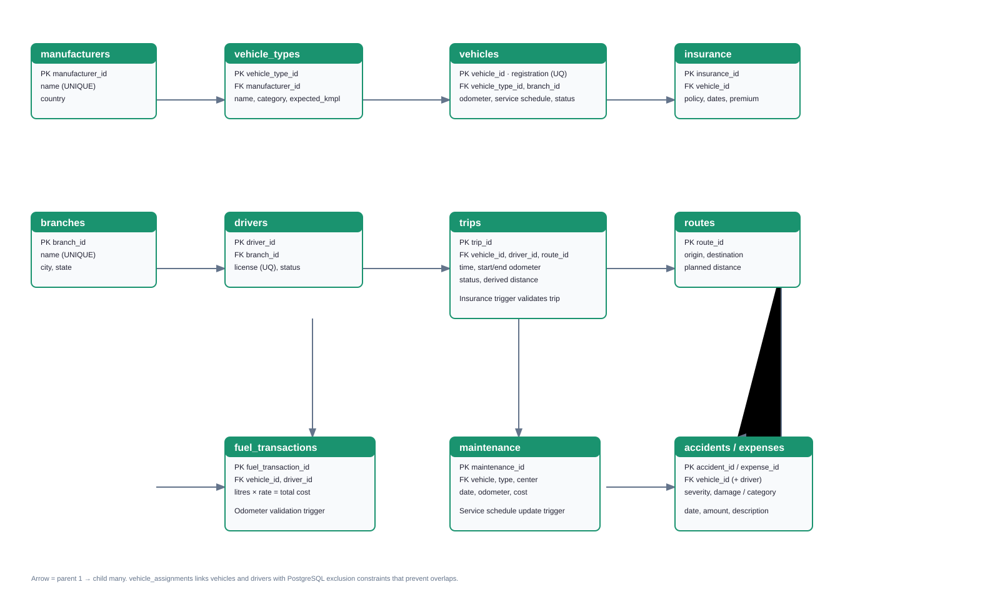

# Database schema

The system uses 16 tables in PostgreSQL: `manufacturers`, `vehicle_types`, `branches`, `vehicles`, `drivers`, `routes`, `trips`, `fuel_transactions`, `maintenance_types`, `service_centers`, `maintenance`, `accidents`, `insurance`, `expenses`, `vehicle_assignments`, and `users`.

The authoritative DDL is [database/schema.sql](../database/schema.sql). Every primary key is a `BIGSERIAL`; foreign keys express the operational relationships, and natural business identifiers (registration, chassis, licence, policy and username) are unique. Check constraints protect dates, amounts, odometers, enum-like states, and Indian registration-number format.

Key cardinalities: manufacturer 1:N vehicle type; vehicle type/branch 1:N vehicle; branch 1:N driver; vehicle/driver/route 1:N trip; vehicle 1:N fuel/maintenance/accident/insurance/expense; and vehicle N:M driver through time-bounded assignments.
